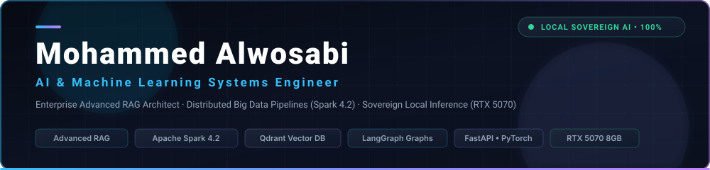

<div align="center">



<br/>

<a href="https://git.io/typing-svg">
  
</a>

<br/>

[](https://github.com/Mo-Alwosabi)
[](https://linkedin.com)
[](mailto:moammen2004@gmail.com)
[](https://maps.google.com/?q=Sanaa,Yemen)

<br/>

**Advanced Sovereign RAG · Large-Scale Distributed Big Data · Local Offline LLMs · Full-Stack AI Architecture**

</div>

---

### 🌟 Executive Profile

I am an **AI & Machine Learning Systems Engineer** specializing in **Enterprise Advanced RAG** architectures and high-throughput **Distributed Big Data Pipelines**.

* **Sovereign & Local AI**: Architecting 100% on-premises RAG platforms with zero cloud telemetry egress and verifiable source-page citations.
* **Large-Scale Big Data**: Designing fault-tolerant ELT pipelines tested on **30M+ records** using **Apache Spark 4.2** and **MongoDB 8.0** with strict Raw-First lineage.
* **Full-Stack AI Systems**: Bridging **Next.js 15** & **React 19** frontends with async **FastAPI** backends and **Qdrant Vector DB**.

> *"Clean architecture, deterministic data contracts, zero-hallucination grounded citations, and reproducible scalability over fragile proof-of-concepts."*

---

<details open>
<summary><h2>🏛️ Featured Enterprise Projects</h2></summary>

### 1️⃣ [Local RAG Workstation](https://github.com/Mo-Alwosabi/Local-RAG-Workstation)
> **Enterprise-Grade Sovereign Retrieval-Augmented Generation Platform & Developer Workstation**

[](https://github.com/Mo-Alwosabi/Local-RAG-Workstation)
[](https://github.com/Mo-Alwosabi/Local-RAG-Workstation)
[](https://github.com/Mo-Alwosabi/Local-RAG-Workstation)
[](https://github.com/Mo-Alwosabi/Local-RAG-Workstation)
[](https://github.com/Mo-Alwosabi/Local-RAG-Workstation)
[](https://github.com/Mo-Alwosabi/Local-RAG-Workstation)

* **100% Sovereign Offline Execution**: Full on-premises document reasoning using private open-weights models (LM Studio / Ollama) with zero data egress, alongside seamless cloud fallback (Google Gemini 1.5 Pro).
* **Deterministic SHA-256 Deduplication**: Cryptographic file and chunk hashing prevents redundant vector generation, saving 100% of duplicate embedding compute costs.
* **Auditable Citations Engine**: Interactive citation pills allowing reviewers to inspect source excerpts, exact page numbers, and cosine similarity scores.
* **Multi-Format Ingestion**: High-throughput parsing for PDF, Word (DOCX), PowerPoint (PPTX), Excel (XLSX), and scanned documents via OCR.
* **Keyboard-Driven Studio UX**: Monochrome developer workstation with sub-second keyboard shortcuts (`_ c`, `_ d`, `_ g`, `_ s`).

---

### 2️⃣ [BigData-Hybrid-Pipeline](https://github.com/Mo-Alwosabi/BigData-Hybrid-Pipeline)
> **Enterprise Hybrid Big Data ELT Pipeline & Serving Engine — Tested on 30 Million Records**

[-orange?style=flat-square&logo=apachespark)](https://github.com/Mo-Alwosabi/BigData-Hybrid-Pipeline)
[-brightgreen?style=flat-square&logo=pytest)](https://github.com/Mo-Alwosabi/BigData-Hybrid-Pipeline)
[](https://github.com/Mo-Alwosabi/BigData-Hybrid-Pipeline)
[](https://github.com/Mo-Alwosabi/BigData-Hybrid-Pipeline)
[](https://github.com/Mo-Alwosabi/BigData-Hybrid-Pipeline)
[-gold?style=flat-square)](https://github.com/Mo-Alwosabi/BigData-Hybrid-Pipeline)

* **Raw-First Guarantee (Zero Data Loss)**: Ingests 100% of raw inbound data into JSON preservation storage with end-to-end lineage tracking (`run_id`, `source_row`, `engine_used`).
* **High-Throughput Distributed PySpark**: Engineered to process **30,000,000 records (12.65 GB)** across 99 partitions at a sustained rate of **125,318 records/sec**.
* **14 Deterministic Quality Rules**: Normalizes Eastern Arabic numerals, validates currency schemas, fixes broken emails, and recalculates totals with an append-only audit trail.
* **12-Code Quarantine Isolation**: Automatically routes malformed records to an isolated `orders_quarantine` collection without crashing upstream pipeline stages.
* **Composite ESR Indexing & Explain**: Reduced index scan overhead on 27.5M records from 27.5M down to 458K documents (a **98.3% scan reduction**).
* **Incremental Watermark Synchronization**: Atomic state-marker synchronization guaranteeing idempotency across restart recovery cycles.

</details>

---

<details>
<summary><h2>🧠 Advanced RAG Architecture Blueprint (7-Stage Pipeline)</h2></summary>

Multi-stage enterprise retrieval pipeline engineered for zero-hallucination factuality and sub-second query latency:

```
┌─────────────────────────────────────────────────────────────────────────────────────────────────┐
│                                 ENTERPRISE ADVANCED RAG PIPELINE                                │
├─────────────────────────────────────────────────────────────────────────────────────────────────┤
│ 1. INGESTION & PARSING   : Multi-Format Extraction (PDF, DOCX, XLSX, Scanned via OCR)           │
│ 2. SEMANTIC CHUNKING     : Adaptive Sliding Window + SHA-256 Content-Addressed Hash             │
│ 3. HYBRID INDEXING       : Dense Vector (Qdrant HNSW) + Sparse Lexical (BM25 Token Inverted)    │
│ 4. DUAL-STAGE RETRIEVAL  : High-Recall Search ➔ Reciprocal Rank Fusion (RRF Algorithm)          │
│ 5. CROSS-ENCODER RE-RANK : Deep Semantic Scoring via BGE-Reranker (Top-K Context Compression)   │
│ 6. AGENTIC REASONING     : LangGraph Directed State Graph (Corrective RAG / Self-RAG Loops)     │
│ 7. GROUNDED CITATION     : Verified Attributions citing Exact Document Filename & Page Numbers  │
└─────────────────────────────────────────────────────────────────────────────────────────────────┘
```

</details>

---

<details>
<summary><h2>🎓 Academic &amp; Theoretical Foundations (Al-Razi University)</h2></summary>

Solid theoretical foundation rooted in academic study of **Artificial Intelligence (Faculty of Computing & Information Technology — Al-Razi University)**:

| Academic Domain | Theoretical, Mathematical & Algorithmic Foundations |
| :--- | :--- |
| **Mathematics & Statistics for AI** | • **Linear Algebra**: Vector spaces, matrix transformations, Singular Value Decomposition (SVD), spectral decomposition, Eigenvalues & Eigenvectors, and geometric vector normalization.<br/>• **Multivariable Calculus**: Partial derivatives, Gradients & Jacobians, Hessian matrices, optimization landscapes, and backpropagation chain rules.<br/>• **Probability & Applied Statistics**: Bayes' Theorem, probability distributions (Gaussian, Bernoulli, Poisson), hypothesis testing, confidence intervals, and Maximum Likelihood Estimation (MLE). |
| **Computer Science & Algorithmic Complexity** | • **Advanced Data Structures**: Balanced Search Trees (AVL, Red-Black), Hash Tables, and Directed Acyclic Graphs (DAGs).<br/>• **Algorithms & Complexity Analysis**: Dynamic Programming, Divide & Conquer, Greedy approaches, and asymptotic time/space complexity analysis ($O(1)$, $O(\log n)$, $O(n)$).<br/>• **Operating Systems & Concurrency**: Memory virtualization, process/thread scheduling, race conditions, atomic operations, and AsyncIO event loops.<br/>• **Software Design Patterns & Clean Code**: SOLID principles, Factory, Strategy, Repository, Observer patterns, and Clean Architecture boundaries. |
| **Classical Machine Learning Theory** | • **Supervised & Unsupervised Learning**: Linear & Logistic Regression, Decision Trees, Random Forests, Support Vector Machines (SVM), and K-Means Clustering.<br/>• **Optimization Algorithms**: Stochastic Gradient Descent (SGD), Mini-batch GD, Momentum, RMSprop, Adam, and AdamW.<br/>• **Regularization & Model Generalization**: Bias-Variance Decomposition, L1 Lasso, L2 Ridge, Dropout mechanisms, and Early Stopping criteria.<br/>• **Evaluation Metrics**: Confusion Matrix, Precision, Recall, F1-Score, Specificity, ROC-AUC, and PR-AUC. |
| **Deep Learning & Transformer Architectures** | • **Deep Neural Networks**: Perceptrons, Multi-Layer Perceptrons (MLP), activation functions (ReLU, GELU, SwiGLU), and backpropagation gradient flow.<br/>• **Computer Vision**: Convolutional Neural Networks (CNNs), pooling operations, feature pyramids, and real-time object detection (YOLOv8 architectures).<br/>• **Transformer Architecture**: Multi-Head Self-Attention, Scaled Dot-Product Attention, Positional Encoding, and Rotary Position Embeddings (RoPE).<br/>• **Embeddings & Large Language Models**: Dense semantic vector representations, Parameter-Efficient Fine-Tuning (LoRA / PEFT), and post-training quantization (GGUF / AWQ). |
| **Database Systems & Big Data Engineering** | • **Relational Database Theory**: Relational algebra, Schema Normalization (1NF through 3NF), ACID transactions, and B-Tree / B+Tree indexing structures.<br/>• **Write-Ahead Logging (WAL)**: Crash-resilience protocols, transaction isolation, and durability guarantees in PostgreSQL and SQLite.<br/>• **Vector Databases**: Hierarchical Navigable Small World (HNSW) graphs, Inverted File with Product Quantization (IVF-PQ), and distance metrics (Cosine Similarity, Dot Product, Euclidean Distance).<br/>• **Distributed Systems & Big Data**: Master-Worker architectures, Resilient Distributed Datasets (RDDs), data partitioning, shuffle optimization, and Apache Spark ELT pipelines. |

</details>

---

<details>
<summary><h2>🛠️ Technical Capabilities &amp; Systems Matrix</h2></summary>

<div align="center">

### 🤖 AI, Machine Learning & RAG
<p>
  
  
  
  
  
  
  
  
  
  
</p>

### ⚡ Big Data & Distributed Data Engineering
<p>
  
  
  
  
  
  
</p>

### 🌐 Backend, APIs & Full-Stack
<p>
  
  
  
  
  
  
  
</p>

### 🚀 DevOps, Infrastructure & QA
<p>
  
  
  
  
  
</p>

</div>

</details>

---

<details>
<summary><h2>⚡ Workstation &amp; Local Compute Infrastructure</h2></summary>

* **GPU**: NVIDIA GeForce RTX 5070 Laptop GPU (8 GB GDDR7 VRAM, CUDA, Tensor Cores, PyTorch `cuda:0` Acceleration)
* **CPU**: AMD Ryzen 9 9955HX (16 Cores, 32 Threads, Next-Gen High-Performance Zen 5 Architecture)
* **RAM**: 16 GB High-Performance System RAM
* **Execution Invariant**: 100% sovereign local offline execution with zero dependency on external cloud APIs when maximum data privacy is required.

</details>

---

<details open>
<summary><h2>📊 Live GitHub Telemetry &amp; Stats</h2></summary>

<div align="center">

<a href="https://github.com/Mo-Alwosabi">
  
</a>

</div>

</details>

---

## 📬 Contact & Professional Engagements

<div align="center">

**Open to AI / Machine Learning Engineer, Advanced RAG Architect, and Distributed Big Data roles.**

[](https://linkedin.com)
[](mailto:moammen2004@gmail.com)
[](https://github.com/Mo-Alwosabi)

<br/>


</div>